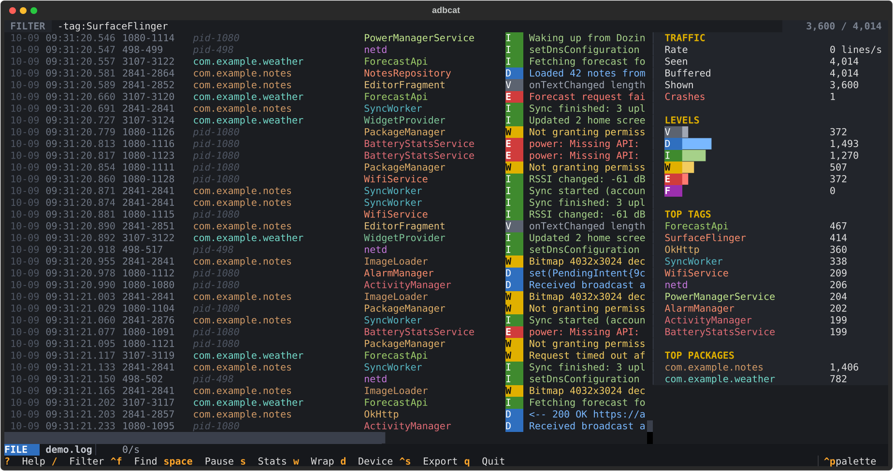
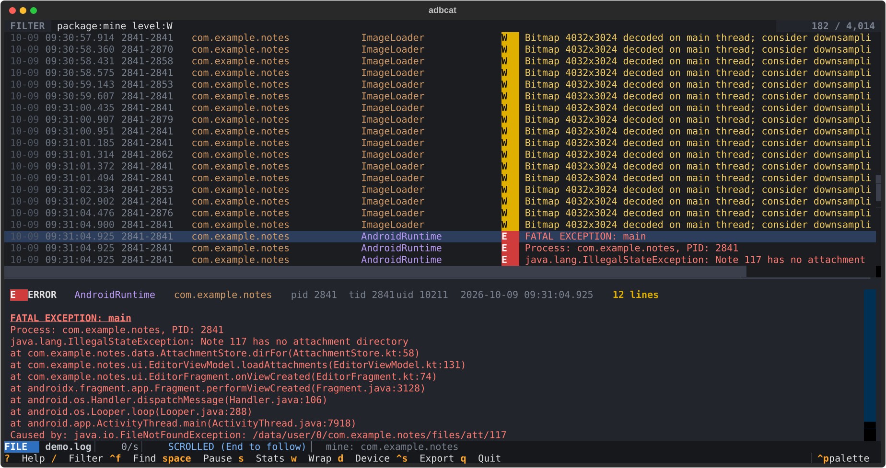

# adbcat

A terminal UI for `adb logcat`. It filters with the same query language as Android Studio's Logcat window, colors every line by level, tag and package, and follows your app across restarts. Run it inside an Android project and it shows that app's logs only.



## Contents

- [Install](#install)
- [Quick start](#quick-start)
- [Filtering](#filtering)
- [Keys](#keys)
- [Project detection](#project-detection)
- [Command line options](#command-line-options)
- [How it works](#how-it-works)
- [Configuration](#configuration)
- [Troubleshooting](#troubleshooting)
- [Development](#development)

## Install

You need:

- Python 3.9 or newer
- `adb` on your `PATH` (it ships with the Android SDK platform-tools)
- A device with USB debugging enabled, or a saved logcat file

Install from GitHub with [pipx](https://pipx.pypa.io/) (recommended, keeps it in its own environment):

```sh
pipx install git+https://github.com/mr-ceo7/adbcat.git
```

or with pip:

```sh
pip install git+https://github.com/mr-ceo7/adbcat.git
```

Either way you get an `adbcat` command. To update later, run `pipx upgrade adbcat` or `pip install --upgrade git+https://github.com/mr-ceo7/adbcat.git`.

## Quick start

```sh
adbcat                       # logs from the connected device
cd ~/AndroidStudioProjects/MyApp
adbcat                       # only MyApp's logs (see Project detection)
adbcat --all                 # every app, even inside a project
adbcat -p com.example.app    # only this package, from anywhere
adbcat -q "level:W -tag:chatty"
adbcat -f saved.log          # browse a saved log instead of a device
```

No device handy? Generate a demo log and open it:

```sh
python scripts/demo_log.py demo.log
adbcat -f demo.log
```

Press `?` inside the app for the full key and query reference.

## Filtering

Press `/` to edit the filter, type a query, and press `Enter`. The view updates as you type. Invalid queries turn red and the previous filter stays active.

| Query | Shows |
|---|---|
| `tag:Foo` | tag contains `Foo` |
| `tag=:Foo` | tag is exactly `Foo` |
| `tag~:^Net.*` | tag matches the regular expression |
| `package:com.example` | app package contains `com.example` |
| `package:mine` | your app (from the project, `-p`, or the `M` key) |
| `process:system_server` | process name, including non-app processes |
| `message:timeout` or `msg:timeout` | message text |
| `line:text` | anywhere in the raw line |
| `level:W` | warnings and above (`V D I W E F`, or `VERBOSE` to `ASSERT`) |
| `age:5m` | lines from the last 5 minutes (`s`, `m`, `h`, `d`) |
| `is:crash` | Java and native crashes |
| `is:stacktrace` | stack trace lines (`at ...`, `Caused by:`, `#00 pc`) |
| `is:anr` | "Application Not Responding" reports |
| `is:bookmarked` | lines you bookmarked with `m` |
| `pid:1234` `tid:1234` `uid:10123` | process, thread or user id |
| `timeout` | plain words match the tag, message, package or process |

Combining terms:

- Terms next to each other must all match: `package:mine level:E`.
- Repeating a key means "either": `tag:Http tag:Sync` shows both tags. This is how Android Studio behaves too.
- `-` excludes: `-tag:chatty`, `-package:com.google`.
- `|` means or, `&` means and, and parentheses group: `(tag:A | tag:B) level:W`.
- `-( ... )` excludes a whole group.
- Values with spaces or `| & ( )` need quotes: `message:"connection reset"`, `tag~:"Http|Sync"`.
- Matching ignores case unless your value contains an uppercase letter.

The filter bar suggests keys, tags, packages and levels as you type; press `→` to accept. `↑` and `↓` step through your filter history. Press `F` to save the current filter or pick a saved one.

## Keys

| Key | Action |
|---|---|
| `/` | edit the filter |
| `↑` `↓` / `j` `k` | select line |
| `PgUp` `PgDn`, `Home` `End` (`g` `G`) | page, top, bottom. `End` resumes auto-scroll |
| `←` `→` / `h` `l` | scroll sideways (wrap off) |
| `Enter` or double-click | detail pane with the full message and its stack trace |
| `Space` | pause the stream. New lines are held, not dropped, and appear when you resume |
| `1`–`6`, `0` | minimum level V, D, I, W, E, F; `0` removes it |
| `t` / `T` | show only / hide the selected line's tag |
| `p` / `P` | show only / hide the selected line's package |
| `M` | make the selected line's package `package:mine` |
| `x` | clear the filter |
| `F` | saved filters |
| `Ctrl+F`, then `n` / `N` | find text without filtering, next / previous match (`/regex/` works) |
| `e` / `E` | next / previous error |
| `m`, `]` / `[` | toggle bookmark, next / previous bookmark |
| `s` | stats panel: lines per second, level counts, top tags and packages, crash count |
| `w` | soft wrap long lines |
| `o` | choose columns (date, time, PID-TID, UID, package, tag) |
| `y` / `Y` | copy the line / the whole stack trace |
| `d` | pick a device |
| `b` | pick log buffers (main, system, crash, events, radio, kernel) |
| `Ctrl+S` | export the filtered lines, or everything, to a file |
| `Ctrl+O` | open a saved log file |
| `c` | clear the screen |
| `C` | clear the device's log buffer (`adb logcat -c`), after confirming |
| `?` | help |
| `q` | quit |

Scrolling up stops auto-scroll so lines don't move while you read. Scroll back to the bottom or press `End` to follow again.



## Project detection

When you run `adbcat` without `-p` or `-q`, it looks for an Android app project:

1. Starting in the current directory, it walks up to the folder that contains `settings.gradle` or `settings.gradle.kts`. An `android/` subfolder is checked too, so Flutter and React Native projects work.
2. It finds modules that apply the `com.android.application` plugin (including `alias(libs.plugins.android.application)`).
3. It reads `applicationId` from each module's build file. If that is missing it uses `namespace`, then the `package` attribute in `src/main/AndroidManifest.xml`.
4. Product flavor ids and `applicationIdSuffix` values (such as `.debug`) are added, so `com.example.app.debug` is matched as well.

If it finds packages, they become `package:mine` and the filter starts as `package:mine`. A notification names the detected packages. If your app isn't running yet the view stays empty until it starts, and a `PROCESS STARTED` line marks the moment.

To see everything, use `adbcat --all`, or press `x` to clear the filter. Ids computed in Gradle code (for example from a variable) can't be read; pass `-p` in that case.

## Command line options

| Option | Meaning |
|---|---|
| `-s`, `--serial SERIAL` | device to use. Without it, adbcat uses the only device or asks |
| `-p`, `--package PKG` | sets `package:mine` and filters to it. Repeat for several packages |
| `-q`, `--query QUERY` | initial filter |
| `-a`, `--all` | don't filter to the detected project |
| `-b`, `--buffers LIST` | comma-separated buffers, default `main,system,crash` |
| `-f`, `--file PATH` | open a saved log file |
| `-T`, `--tail N` | load only the last N lines from the device at startup |
| `--max-lines N` | lines kept in memory, default 200000 |

## How it works

- **Stream.** adbcat runs `adb logcat -v threadtime -v year -v uid` and parses each line. On devices too old for `-v year`/`-v uid` it falls back to plain `threadtime`.
- **Packages.** logcat lines only carry a PID. adbcat polls `ps` on the device every 2 seconds and watches ActivityManager `Start proc` lines to map PIDs to packages and process names. When an app process starts or dies it inserts a `PROCESS STARTED` or `PROCESS ENDED` line, so `package:` filters keep working across restarts.
- **Reconnects.** If the device disconnects, adbcat waits for it. When it comes back, logcat restarts from the last timestamp received (`-T`), and lines already shown are skipped.
- **Memory.** The newest 200,000 lines are kept (`--max-lines`). Older lines roll off. Only that many lines are read from the device at startup.
- **Rendering.** Only visible rows are drawn, so filtering and scrolling stay fast with the full buffer loaded.
- **Saved files.** Exports keep the original logcat text, so `adbcat -f` can reopen them and so can other tools. Package names in a saved file are only known where the file contains `Start proc` lines.

## Configuration

Settings are stored in `~/.config/adbcat/config.json` (or `$XDG_CONFIG_HOME/adbcat/`): filter history, saved filters, visible columns, wrap, column widths and the line limit. Edit the file while adbcat is closed to change `tag_width`, `package_width` or `max_lines`.

## Troubleshooting

| Problem | Fix |
|---|---|
| `adb was not found on PATH` | Install Android SDK platform-tools and add them to `PATH` |
| Status bar shows `WAITING ... unauthorized` | Unlock the phone and accept the USB debugging prompt |
| `package:mine` shows nothing | The app isn't running, or the detected id differs from the installed one. Check the notification at startup, or use `-p` |
| The kernel buffer fails | Reading it usually needs a rooted device |
| Copy (`y`) doesn't reach the clipboard | adbcat uses the terminal's OSC 52 sequence and also `wl-copy` or `xclip` when they are installed |
| Lines from before adbcat started show `pid-1234` | Those processes ended before adbcat could see them, so the package is unknown |

## Development

```sh
git clone https://github.com/mr-ceo7/adbcat.git
cd adbcat
pip install -e ".[test]"
pytest
```

| Path | Contents |
|---|---|
| `adbcat/model.py` | line parser, `Entry`, bounded `LogStore` |
| `adbcat/query.py` | query language: tokenizer, parser, matchers |
| `adbcat/adb.py` | logcat stream with reconnects, `ps` process tracker, device list |
| `adbcat/detect.py` | Android project and application id detection |
| `adbcat/logview.py` | virtualized log widget (rendering, wrap, selection) |
| `adbcat/app.py` | the Textual app: filter bar, panels, key actions |
| `adbcat/screens.py` | dialogs: devices, buffers, columns, saved filters, export, help |
| `scripts/demo_log.py` | synthetic log for demos and screenshots |
| `scripts/screenshots.py` | regenerates `docs/*.svg` |

## License

MIT. See [LICENSE](LICENSE).
